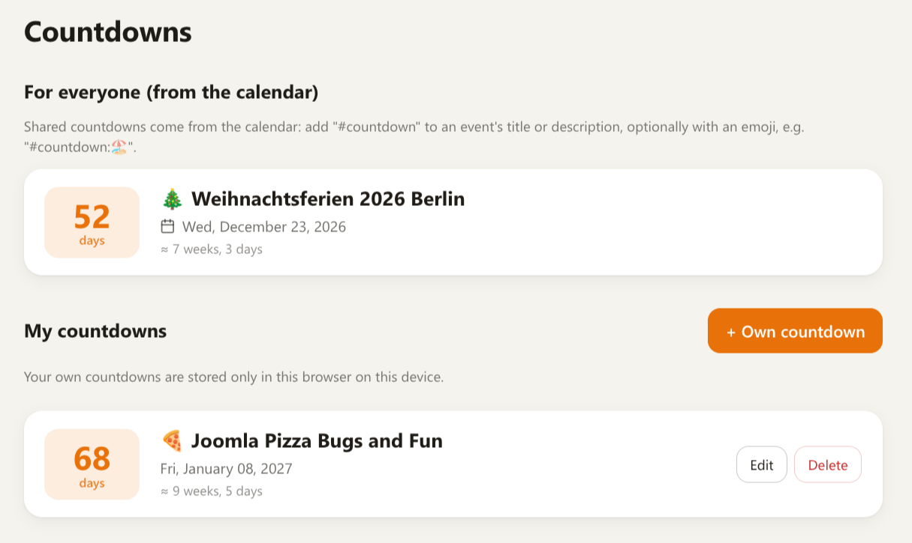
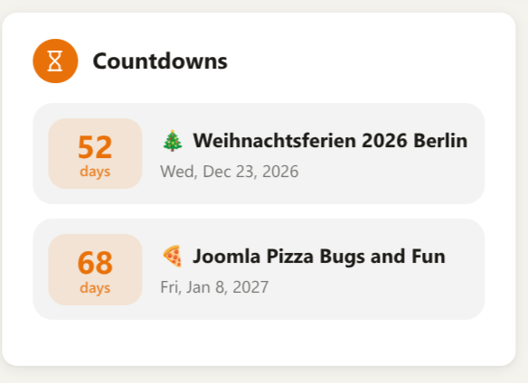

# Yuvomi Custom Modules

Drop-in modules for [Yuvomi](https://github.com/ulsklyc/yuvomi), the self-hosted family planner. Each module lives in its own folder under `modules/` and follows the format described in Yuvomi's [MODULES.md](https://github.com/ulsklyc/yuvomi/blob/main/MODULES.md). Nothing in Yuvomi's core is modified.

These modules are community work and are not part of, or endorsed by, the Yuvomi project.

| Module | What it does | Version |
| --- | --- | --- |
| [`countdown`](modules/countdown) | Countdowns to dates: shared ones from calendar events, personal ones per browser, plus a dashboard widget | 1.3.2 |

## Countdown

Counts the days until the next holiday, birthday or any other date, and shows them on a page and as a dashboard widget.






- **Shared countdowns** come straight from the Yuvomi calendar. Add `#countdown` to the title or description of an event and everyone who can see that event sees the countdown. No extra service and no extra storage are needed.
- **Optional emoji:** write `#countdown:🏖️` (the colon is optional). In the description the emoji only shows up in the countdown, not in the calendar. In the title it shows up in both.
- **Running events** show how many days are left, past shared events are hidden.
- **Personal countdowns** are created on the module page and stored in the browser's local storage, separately for each user. They can repeat every year (handy for birthdays). They are not shared between devices.
- **Dashboard widget** with the next countdowns (option `limit`, 1 to 10, default 3).
- German and English texts, chosen from the page language.

The module only reads events through Yuvomi's own `/api/v1/calendar/search`, using the signed-in user's session. It contacts no external service, loads no CDN and writes nothing to the server.

### Install

Pick one way.

**1. From Settings (GitHub URL).** An admin sets `MODULES_ALLOW_WEB_INSTALL=true` in the `.env` and restarts Yuvomi. Then open Settings → Modules → Add custom module and enter this repository's URL. Yuvomi finds `modules/countdown/module.json` by itself. The module arrives disabled; approve and enable it in the same browser session.

**2. By hand.** Copy the folder `modules/countdown` into the modules folder of your Yuvomi (`MODULES_DIR`, mounted at `/app/modules` in the container), so that `/app/modules/countdown/module.json` exists:

```bash
docker cp modules/countdown/. yuvomi:/app/modules/countdown/
```

Replace `yuvomi` with the name of your container. The folder name must match the module id `countdown`. Then enable the module under Settings → Modules → Active modules. No restart is needed.

After an update, reload the page without cache (Ctrl+Shift+R), because Yuvomi caches its files with a service worker.

### Use

1. Create or edit an event in the calendar.
2. Add `#countdown` (or `#countdown:🏖️`) to the title or description.
3. Open **Countdowns** in the menu, or add the Countdowns widget to the dashboard.

Personal countdowns: open the module page and choose **Own countdown**.

### Permissions

The module declares the permission key `ext:countdown`. Yuvomi lists it under Settings → Administration → Roles & permissions. The module itself reads only calendar data, which Yuvomi already restricts to what the signed-in user may see.

### Compatibility

Developed against the API of Yuvomi 2.83.0. Yuvomi does not check module compatibility, so after a Yuvomi update, check that the module still works. The only server call is `GET /api/v1/calendar/search`.

### Limits

- The shared list relies on Yuvomi's full-text search. An event that only contains the word "countdown" is ignored, only the `#countdown` marker counts.
- For recurring events Yuvomi returns the next occurrence, and so does the module.
- Personal countdowns live in the browser. Clearing site data removes them.

## Author

N-Systeme, Niko Winckel · [n-systeme.de](https://n-systeme.de) · [@jamfx](https://github.com/jamfx)

Bugs and ideas: please open an [issue](https://github.com/jamfx/Yuvomi-Custom-Modules/issues).

## License

[MIT](LICENSE)
